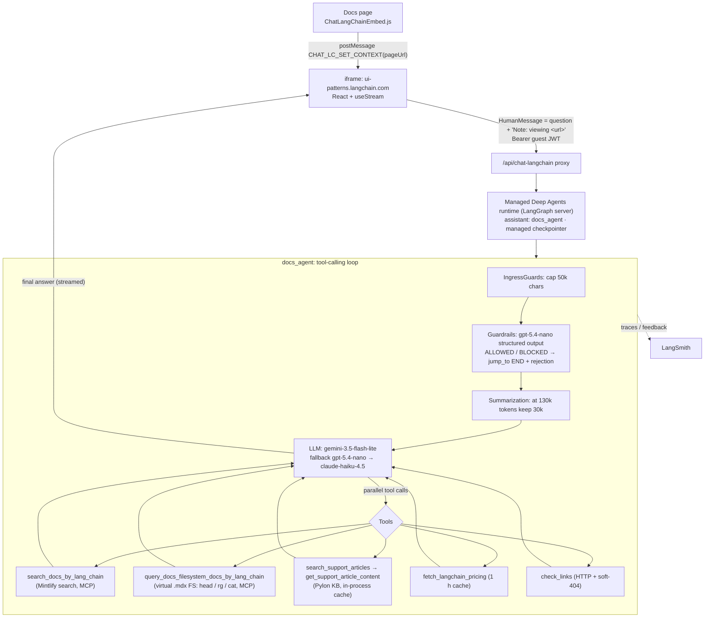

# Chat LangChain (docs.langchain.com): reverse-engineering report

Target: the "Chat LangChain" assistant panel on https://docs.langchain.com (opens with ⌘/Ctrl+I
or any link to `chat.langchain.com`).
Captured: 2026-10-12.
Tooling: [REA](https://github.com/morluto/rea) `rea-agents@6.4.0` (CDP page inspection and bundle
fingerprinting), plus extraction of the RSC payload, the iframe app's Vite chunks, a
`tools/list` probe of the public docs MCP server, and the open-source backend
[`langchain-ai/chat-langchain`](https://github.com/langchain-ai/chat-langchain) at commit
`ae50e7a` (2026-10-12). One live question was sent as an anonymous guest to confirm the
deployed agent behaves like the repo.

Reproduce: [`scripts/langchain_chat_capture.sh`](../../scripts/langchain_chat_capture.sh).

## TL;DR

* **How it knows which page you're on:** it doesn't infer anything. A small script on the docs
  site (`ChatLangChainEmbed.js`, injected through Mintlify's custom-JS feature) sends
  `window.location.href` to the chat iframe with `postMessage({type: "CHAT_LC_SET_CONTEXT", pageUrl})`.
  The script resends it after every SPA navigation by monkey-patching `history.pushState` and
  `history.replaceState` and listening for `popstate` and `hashchange`. The chat app keeps the
  latest URL in a React ref. On send, it **appends one line to your question**:
  `"\n\n---\nNote: The user is asking this question while viewing the following documentation page: <url>"`.
  The system prompt then says *"If the user is asking a question while viewing a page, always
  read that page first."*
* **The RAG pipeline is agentic, not a vector-store chain.** There is no embedding or
  retrieval step in their code. A single tool-calling agent (`docs_agent`, a LangChain
  `create_agent`/Deep Agent hosted on "Managed Deep Agents", the LangGraph server) gets tools
  and decides when to call them:
  1. `search_docs_by_lang_chain(query)`: Mintlify's hosted search over the docs (served by the
     docs site's own MCP server at `https://docs.langchain.com/mcp`). It returns titles,
     links, page paths and one chunk.
  2. `query_docs_filesystem_docs_by_lang_chain(command)`: the same MCP server exposes the
     whole docs site as a **virtual read-only filesystem of `.mdx` pages**. The agent runs
     `head -200 /path.mdx` or `rg -C 3 "term" /path.mdx` to read full pages. This is the
     "retrieve full document" step.
  3. `search_support_articles(collections)` and `get_support_article_content(id)`: Pylon
     support KB (titles listed per collection, the LLM picks IDs, then reads them).
  4. `fetch_langchain_pricing()`: live scrape of the pricing page with a 1-hour cache.
  5. `check_links(urls)`: HTTP-validates every URL before it appears in the answer,
     including soft-404 detection.
* **Around the agent:** an ingress cap (50k chars), an LLM guardrail classifier (structured
  output, ALLOWED/BLOCKED, can jump straight to END with a polite refusal), summarization at
  130k tokens (keep last 30k), retry and model-fallback middleware, and LangSmith tracing
  with thumbs-up/down feedback and shareable traces.
* **Models (repo default):** `google_genai:gemini-3.5-flash-lite` for the agent, falling back
  to `gpt-5.4-nano` and then `claude-haiku-4.5`. The guardrail uses `gpt-5.4-nano`. The
  prompts are pulled from LangSmith Prompt Hub at startup, with `instructions.md` as the
  local mirror.

## 1. Front end: how page awareness works

### 1.1 Three layers

| Layer | Where | What it does |
|---|---|---|
| Docs site | `docs.langchain.com`, Mintlify (Next.js App Router, RSC). REA: Next.js + React fingerprints, 150 scripts | Ships custom JS files configured in Mintlify: `language-toggle.js`, **`ChatLangChainEmbed.js`**, `integration-downloads-table.js`, `default-changelog-filter.js`, `changelog-navigation.js`. Mintlify's built-in assistant is switched off (`assistantConfig.enableAskAiButton: false`) |
| Widget shell | `ChatLangChainEmbed.js` (about 580 lines, compiled from `src/ChatLangChainEmbed.ts`) | Builds a right-side `<aside>` panel, lazily creates the iframe, syncs theme and page URL, resizes the layout |
| Chat app | `https://ui-patterns.langchain.com/react/#/chat-langchain`, a Vite + React app, chunk `ChatLangChainPage-*.js` | Renders the chat with the LangGraph JS SDK's React stream hook (`useStream`-style `submit`/`stop`/`messages`) and talks to the agent through a same-origin proxy `/api/chat-langchain` |

### 1.2 Message protocol between the docs page and the iframe

| Direction | `type` | Payload | When |
|---|---|---|---|
| iframe → page | `CHAT_LC_READY` | none | the chat app has mounted (fallback: 1.5 s after iframe `load`) |
| page → iframe | **`CHAT_LC_SET_CONTEXT`** | `pageUrl: window.location.href`, `segmentAnonymousId` | on ready, on panel open, after `pushState`/`replaceState` (via `queueMicrotask`), on `popstate`, on `hashchange` |
| page → iframe | `CHAT_LC_SET_THEME` | `theme: "light"/"dark"` | `MutationObserver` on `<html>` `class`, `data-theme` and `style` |
| page → iframe | `CHAT_LC_TOGGLE_HISTORY`, `CHAT_LC_SET_HISTORY_VIEW` | `open` | header buttons and close |
| iframe → page | `CHAT_LC_PROMPT_SENT`, `CHAT_LC_THREAD_ID`, `CHAT_LC_HISTORY_VIEW`, `CHAT_LC_HAS_SAVED_THREADS` | thread id and flags | the header updates the "open in chat.langchain.com?threadId=…" link and the history dot |

`CHAT_LC_SET_CONTEXT` is posted with a pinned target origin (`https://ui-patterns.langchain.com`).
The other messages use `"*"`.

The core of the shell, trimmed:

```js
function sendPageContext() {
  if (iframe && panelReady && iframe.contentWindow) {
    iframe.contentWindow.postMessage(
      { type: "CHAT_LC_SET_CONTEXT", pageUrl: window.location.href,
        segmentAnonymousId: lcGetSegmentAnonymousId() },   // Segment ajs_anonymous_id
      lcEmbedOrigin());
  }
}
// Mintlify is an SPA: no page load on navigation, so patch the History API
history.pushState    = function (d, u, url) { var r = origPushState(d, u, url);    queueMicrotask(sendPageContext); return r; };
history.replaceState = function (d, u, url) { var r = origReplaceState(d, u, url); queueMicrotask(sendPageContext); return r; };
window.addEventListener("popstate", sendPageContext);
window.addEventListener("hashchange", sendPageContext);
// Hijack every link to chat.langchain.com and open the side panel instead
document.addEventListener("click", e => { const a = e.target.closest('a[href^="https://chat.langchain.com"]'); if (a) { e.preventDefault(); openPanel(); } }, true);
```

### 1.3 What the chat app does with the URL (`ChatLangChainPage-*.js`)

```js
// listener: store the latest URL, don't re-render
if (e.data?.type === "CHAT_LC_SET_CONTEXT") pageUrlRef.current = e.data.pageUrl;

// on submit
const s = pageUrlRef.current?.replace(/^https?:\/\/(localhost|127\.0\.0\.1)(:\d+)?/, "https://docs.langchain.com");
const text = s
  ? `${question}\n\n---\nNote: The user is asking this question while viewing the following documentation page: ${s}`
  : question;
stream.submit(
  { messages: [{ type: "human", content: text }] },
  { metadata: { user_id: guestId, source_type: "Docs-Embed", segment_anonymous_id } });
```

So the page context is **plain text inside the user turn**. It is not a separate state field or
a system-prompt variable. Three consequences:

* It is stored in the thread history. Every past turn remembers which page it was asked on.
  The UI hides it: when rendering human messages the chat app strips it with
  `/\n\n---\nNote: The user is asking this question while viewing the following documentation page: .+$/s`.
* The guardrail classifier sees it too. Its prompt tells it to "pay attention to whether
  the user is viewing langchain docs" when deciding whether, say, a translation request is in scope.
* The agent turns the URL into a filesystem path (`/oss/python/...` → `/oss/python/....mdx`)
  and reads it with the docs-filesystem tool. Live check: the question *"How do I use this?"*
  asked from `/oss/python/langchain/middleware/built-in` ran
  `search_docs_by_lang_chain("middleware")`, then
  `query_docs_filesystem_docs_by_lang_chain("head -100 /oss/python/langchain/middleware/built-in.mdx")`,
  then `check_links([...built-in])`, then answered about prebuilt middleware with Python code.
  It even matched the page language (Python) from the `/oss/python/` URL prefix, as the prompt asks.

### 1.4 Sessions, history, feedback

| Item | Implementation |
|---|---|
| Identity | `POST /api/chat-langchain/identity/guest` returns a signed guest JWT (30-day TTL, actor `guest:<id>`), stored in `localStorage` (`chat-langchain-guest-token`, `-exp`, `langgraph-user-id`) and refreshed 60 s before expiry and on any 401. Signed-in users on chat.langchain.com use Supabase (multi-region) |
| Threads | LangGraph threads, actor-scoped server side. History is `threads.search({metadata: {user_id}, sortBy: "updated_at", limit: 100})`. Title and last message are written back into thread metadata from the browser (deterministic truncation, no LLM) |
| New chat | reloads the iframe with `&_lcSession=<Date.now()>` |
| Stop | `runs.cancel(threadId, runId)` |
| Feedback | `POST /run-feedback` `{run_id, key: "ux.thumb_vote", sentiment, comment}`; `POST /share-trace` returns a public LangSmith trace link. Both are proxied server side so the LangSmith key never reaches the browser |
| Analytics | rate-limited client events `chat_lc_viewed`, `chat_lc_prompt_submitted` (with `has_doc_context`), `chat_lc_response_completed` (with `duration_ms`), …. The docs site's Segment `ajs_anonymous_id` is forwarded into run metadata as `segment_anonymous_id` so chat runs can be joined to docs browsing |
| Starter questions | "What are deep agents and how do I get started?", "How do I build a React app around a Deep Agent?", "How do I stream subagent output to my frontend with useStream?" |

## 2. Back end: the RAG architecture



### 2.1 Agent definition (`agent.py`)

```python
agent = define_deep_agent(              # managed_deepagents: wraps create_deep_agent
    name="docs_agent",
    model="google_genai:gemini-3.5-flash-lite",
    tools=[search_support_articles, get_support_article_content,
           fetch_langchain_pricing, check_links],      # + MCP tools appended at compile
    middleware=[IngressGuardsMiddleware(),
                GuardrailsMiddleware(model="openai:gpt-5.4-nano", block_off_topic=True),
                CustomSummarizationMiddleware(trigger=("tokens", 130_000), keep=("tokens", 30_000)),
                tool_retry_middleware, model_retry_middleware, model_fallback_middleware],
    disable_memory=True,                 # no cross-thread memory yet
    metadata=build_docs_agent_trace_metadata())
```

The docs tools are not written in Python. They come from an MCP connector (`connectors/mcp.py`):

```python
define_mcp_servers(prefix_tool_name_with_server_name=False,
                   mcp_servers={"langchain-docs": {"transport": "http",
                                                   "url": "https://docs.langchain.com/mcp"}})
```

The live stream shows the node sequence `PatchToolCallsMiddleware.before_agent →
IngressGuardsMiddleware.before_agent → GuardrailsMiddleware.before_agent →
CustomSummarizationMiddleware.before_model → model → tools → …`. `PatchToolCallsMiddleware` is
the Deep Agents default that repairs dangling tool calls.

### 2.2 The retriever: Mintlify's docs MCP server

`tools/list` on `https://docs.langchain.com/mcp` (server "Docs by LangChain") returns:

| Tool | Input | Returns |
|---|---|---|
| `search_docs_by_lang_chain` | `query` | up to 10 hits, **each a separate MCP text block**: `Title`, `Link`, `Page` (path) and `Content` = one whole heading-level section of raw MDX. Hits range from about 250 characters to 24,000; one search returned 12,000 to 56,000 characters in my runs. Python and JS copies of the same page both appear. |
| `query_docs_filesystem_docs_by_lang_chain` | `command` | stdout of a sandboxed, stateless, read-only shell over an in-memory FS built from doc chunks: `rg grep find tree ls cat head tail stat wc sort uniq cut sed awk jq`. Root: `/api-reference /langsmith /oss /openapi …`. OpenAPI specs are mounted under `/openapi/…`. Output capped at 30 KB |
| `submit_feedback` | `path`, `feedback` | reports a doc problem to the docs team |

The **indexing side is Mintlify's**. Chunking, embeddings and ranking for `search_docs` run in
Mintlify's hosted search. The filesystem view is rebuilt from the same published `.mdx`, so
the index refreshes on every docs deploy and LangChain runs no ingestion pipeline of its own.
That is the main architectural choice: **search to discover, then read whole pages**, instead of
stuffing top-k chunks into the prompt.

### 2.3 Prompted retrieval policy (`instructions.md`, pulled from Prompt Hub in prod)

* Answer greetings and clarifications directly. Everything technical **must** use tools,
  "NEVER answer from memory".
* **Round 1 (parallel):** one `search_docs_by_lang_chain` per distinct concept, plus
  `search_support_articles` with the relevant collections.
* **Round 2 (parallel):** read the top 1-3 pages (`head -200 a.mdx b.mdx` or `rg -C 3`), plus
  1-3 support articles by ID. Search results alone are "never sufficient grounding".
* **Hard cap of 2 search/read rounds.** Re-searching a query that is already in history is
  forbidden (it wastes context).
* **Query normalisation for cache hits:** 1-2 lowercase singular nouns ("middleware",
  "deployment", "streaming" + "subgraphs"), with a fixed synonym map (auth→"authentication",
  subagent→"subgraphs", checkpoints→"persistence", …).
* If the user is viewing a page, **read that page first**. Answer in that page's language
  (Python or JS).
* Build deep links from headings (`#stream-subgraph-outputs`) and validate every URL with
  `check_links`. Never link the stale `python.langchain.com`/`js.langchain.com`.
* Fixed answer format: bold one-sentence answer, short explanation, code, `##` sections,
  "**Relevant docs:**" link list last, no emojis and nothing after the links. A
  self-check list runs before sending.
* Pricing goes only through `fetch_langchain_pricing`.

### 2.4 Guardrails

`GuardrailsMiddleware.abefore_agent` classifies the latest human message plus up to 3 earlier
human messages (200 chars each) with `with_structured_output({decision, explanation})`, a
10 s timeout and 2 retries per model. It is lenient by default. Software, AI, MCP, billing and
follow-ups are allowed. NSFW, roleplay and harmful uses are blocked. When blocked, it generates
a short rejection with an LLM and returns `jump_to: "end"`, so the main agent never runs. All
blocked queries and 1% of allowed ones are logged to the LangSmith dataset
`Chat-LangChain-Guardrails-Samples` for evaluation.

### 2.5 Support KB, pricing, link check

* **Pylon KB:** at first use it fetches every article (with content) and caches it in process.
  Search takes only `collections` (no free-text query). It returns `{id, title, url}` for the
  public, published articles, and the LLM chooses which IDs to read. Retrieval works by
  "LLM reads the table of contents".
* **Pricing:** fetches `langchain.com/pricing`, caches it in process for 1 hour.
* **check_links:** async HEAD/GET with an in-memory cache. For domains known to return soft
  404s it reads the first 8 KB and looks for "not found" in the title.

## 2.6 Live tool-call captures (2026-10-12)

I asked three questions through the public guest flow (`stream_mode: updates`) and timed every step.
I also called the MCP server directly.

| Question | Steps the agent took | Total | Input tokens, first → last model call |
|---|---|---|---|
| "How do I stream subagent output to my frontend with useStream?" | guardrail; search ×2 + support search (parallel); read 1 page + 1 article (parallel); search again; `check_links`; answer | 10.9 s | 11.7k → 38.5k |
| "My LangSmith deployment build fails with ModuleNotFoundError…" | guardrail; search + support search; search ×2; `check_links`; answer (**no page was read**) | 13.1 s | 11.7k → 50.4k |
| "What does this page's first example do?" + `/oss/python/langgraph/persistence` | guardrail; search + support search; `find / -name "*persistence*"` + article; `head -100 persistence.mdx`; `check_links`; answer | 9.6 s | 11.7k → 22.5k |

* **Step costs:** guardrail about 1 s. Each model call 0.8 to 1.5 s (one took 3.5 s). Mintlify search 1.0 to 1.5 s inside
  the bot (0.5 s when called directly). Filesystem reads about 0.9 s inside the bot (0.2 to 0.4 s directly). Support KB
  and `check_links` 0.02 to 0.07 s, because both are cached in process. Model: `gemini-3.5-flash-lite`.
* **The search results are the real retrieval.** The prompt says search returns "a single line of content", but it
  returns full sections, so the agent often answers from them without reading a page (question 2). Base context
  (system prompt plus tool definitions) is about 11.7k tokens, and each search adds 3k to 14k.
* **Page context did not save a step.** With the page URL in the question, the agent still searched and ran `find`
  before reading the page.
* **Wire format:** stateless streamable HTTP (no `mcp-session-id`). Each call is one `POST /mcp` with a JSON-RPC
  `tools/call`, answered as `text/event-stream` with one `event: message`. The result is
  `{"content": [{"type": "text", "text": ...}, ...]}` with no `structuredContent`. `langchain-mcp-adapters` passes the
  block list through as the `ToolMessage` content.
* **The filesystem tool behaves like a bash interpreter over a virtual, read-only file tree.** Pipes, `&&` and `cd`
  work inside one call. Errors come back as text with exit codes (`bash: rm: command not found`, exit 127;
  `No such file or directory`, exit 1), never as MCP `isError`. Output is cut at about 30,000 characters with
  `... (output truncated)`; for example, `cat` of a 47,330-byte page is cut off.
* **Resources:** the server exposes one resource, `mintlify://skills/langchain`, an 11k-character skill file in Markdown.
  The bot did not read it in my runs.

## 2.7 How the docs reach Mintlify and how Mintlify serves them to agents

Sources: the `langchain-ai/docs` repo (commit `8ad078e`), Mintlify's own docs read through Mintlify's MCP server
(`https://www.mintlify.com/docs/mcp`), and live checks on docs.langchain.com.

**Publishing (LangChain's side).**
1. Writers edit `.mdx` pages plus `src/docs.json` (navigation and site config) in `langchain-ai/docs`. One source page
   can hold both languages, using `:::python` and `:::js` blocks.
2. On merge, the GitHub Action `publish.yml` runs `make build`. The Python `pipeline/` turns `src/` into `build/`:
   - Each OSS page is rendered twice, to `build/oss/python/...` and `build/oss/javascript/...`. This is why every
     search returns Python and JS copies of the same page.
   - Links are resolved and shared snippets copied.
   - `ChatLangChainEmbed.js` is copied in from the npm package `@langchain/docs-sandbox`.
3. The action force-pushes `build/` to the `prod` branch. Mintlify's GitHub App watches that branch and deploys it;
   PRs get preview branches. LangChain's pipeline does not generate `llms.txt`; Mintlify does.

**What Mintlify builds from the deployed tree (Mintlify's side).**

| Output | Where | What it is |
|---|---|---|
| HTML site | `docs.langchain.com/...` | Next.js on Vercel behind Cloudflare. Any `.js` file in the content directory is injected on every page, which is how the chat widget gets there |
| Markdown version of every page | `<page>.md` (`text/markdown`) | Raw page with a header pointing agents to `llms.txt` |
| `llms.txt` / `llms-full.txt` | site root | Page index (LangChain's is split into 2 section files for 1,695 pages) and all content in one file (15.9 MB) |
| Search index | behind the search tool and the site search bar | Pages split into heading-level chunks. Mintlify's docs describe "full-text search and semantic understanding" and a per-chunk relevance score that `boost` multiplies |
| Virtual filesystem | behind `query_docs_filesystem_*` | The same pages as read-only `.mdx` files, plus OpenAPI specs, queried with shell commands |
| Search MCP server | `/mcp` (public) and `/authed/mcp` (OAuth, scoped to user groups) | Tools: search, filesystem, `submit_feedback`; skill files as resources. Optional `version` and `language` search filters exist for multi-version or multi-language sites |
| Discovery | `/.well-known/mcp`, `/.well-known/mcp/server-card.json`, `Link` and `X-Llms-Txt` response headers | Lets agents find the MCP server and `llms.txt` without configuration |

LangChain's `/.well-known/mcp` names the underlying host `langchain-5e9cc07a.main-kill-isr.mintlify.me/mcp`.
`docs.langchain.com/mcp` is the same server on LangChain's domain.

## 3. Build the same thing yourself (minimal recipe)

1. **Expose your docs as tools.** If your docs are on Mintlify, the `/mcp` endpoint
   already gives you search and filesystem tools. Otherwise build two tools: `search(query)`
   (BM25 or vector over chunks, returning title, path and a snippet) and
   `read(path, grep=None, head=200)` that returns the full page.
2. **Agent:** `create_agent(model, tools=[search, read, check_links], system_prompt=...)`
   (or `create_deep_agent`). Middleware: guardrail `before_agent` with `jump_to="end"`,
   summarization, retries and fallbacks. Deploy on a LangGraph server so you get threads and a
   checkpointer.
3. **Embed widget on your site:** a sidebar iframe. On ready, open and every navigation
   (patch `history.pushState`/`replaceState`, listen to `popstate`/`hashchange`), run
   `iframe.contentWindow.postMessage({type: "SET_CONTEXT", pageUrl: location.href}, chatOrigin)`.
4. **Chat app:** keep `pageUrl` in a ref and append
   `"\n\n---\nNote: The user is asking this question while viewing: <url>"` to the human
   message before `useStream().submit(...)`.
5. **Prompt:** "If the user is viewing a page, read it first", plus a bounded two-round
   search-then-read policy and link validation.

## 4. Scope and limits

* Only public assets were read: the docs page HTML/RSC, the iframe app's JS, the public MCP
  endpoint (`initialize`, `tools/list`, one search and one `tree` call) and the MIT-licensed
  GitHub repo. One question was sent through the public guest flow, the same path an anonymous
  visitor uses. The guest thread is scoped to a guest identity that no longer exists, so it
  could not be deleted afterwards (404).
* The production prompts come from LangSmith Prompt Hub (`…:production` tags), so the live
  wording can differ from `instructions.md`. The live run matched its tool policy, with one
  exception: it skipped the support KB search for that question.
* Mintlify's search internals (chunk size, embedding model, ranking) are not visible from
  outside.
